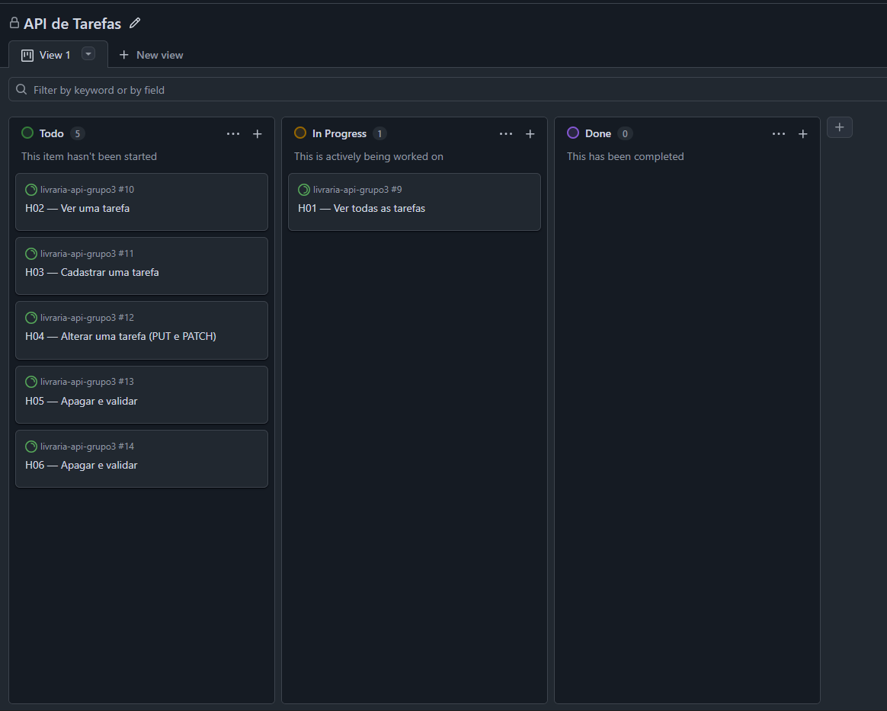
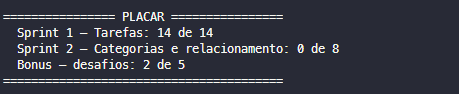

# API de Tarefas

**Aluno(a):** Luis Miguel Pereira da Silva

API de gestão de tarefas feita com Node.js, Express e MySQL, no padrão MVC.

## Como rodar

1. `npm install`
2. Copie o arquivo `.env.example` para `.env` e coloque a senha do seu MySQL.
3. No MySQL Workbench, abra e rode o arquivo `src/database/todo.sql` (raio ⚡).
4. `npm run dev` → o terminal mostra `Conectado ao MySQL!`.
5. Para conferir a API, em outro terminal: `npm run conferir`.

## Endpoints

### Sprint 1 — Tarefas

| Método | Rota | O que faz | Status de sucesso |
|---|---|---|:---:|
| GET | `/tarefas` | Lista todas as tarefas | 200 |
| GET | `/tarefas/:id` | Busca uma tarefa pelo ID | 200 |
| POST | `/tarefas` | Cadastra uma tarefa | 201 |
| PUT | `/tarefas/:id` | Substitui os dados de uma tarefa | 200 |
| PATCH | `/tarefas/:id` | Altera somente os campos enviados | 200 |
| DELETE | `/tarefas/:id` | Apaga uma tarefa | 204 |

Os erros das rotas de tarefa seguem o contrato do projeto: ID não numérico responde 400, tarefa inexistente responde 404 e dados inválidos respondem 400.

**Campos da tarefa:**

- `id`: número gerado pelo banco.
- `titulo`: texto obrigatório.
- `prioridade`: `baixa`, `media` ou `alta`.
- `status`: `a_fazer`, `fazendo` ou `feita`.

### Bônus B1 — Filtros

| Método | Rota | O que faz | Status de sucesso |
|---|---|---|:---:|
| GET | `/tarefas?status=fazendo` | Lista somente as tarefas com status fazendo | 200 |
| GET | `/tarefas?prioridade=alta` | Lista somente as tarefas com prioridade alta | 200 |

**Sprint 2 — Categorias e relacionamento:** ainda não iniciado. Esta etapa será documentada quando o professor passar as orientações do Dia 2.

## Diagrama de classes

---

# Acompanhamento do projeto

**Quadro usado:** GitHub Projects.

## Sprint 1 — Tarefas

### Quadro no início

### Quadro no fim

### Placar final do npm run conferir

Resultado registrado após a execução dos testes:

- **Sprint 1 — Tarefas: 14 de 14**
- **Sprint 2 — Categorias e relacionamento: 0 de 8** (não iniciado; fora do escopo desta entrega)
- **Bônus — desafios: 2 de 5** (os dois filtros B1 foram aprovados)

### Quadro final do projeto

As imagens acima registram o quadro no início e no fim do Sprint 1.

## Sprint 2 — Categorias e relacionamento

Sprint 2 ainda não iniciado. Aguardando as instruções do professor para começar esta etapa.

## Reflexão final

- **O que aprendi:** Aprendi a organizar uma API no padrão MVC, separando rotas, controllers e services. Também pratiquei os métodos HTTP GET, POST, PUT, PATCH e DELETE, consultas ao MySQL e validação dos dados recebidos.
- **O que foi mais difícil:** A parte mais difícil foi implementar as alterações com PUT e PATCH sem perder os dados que não deveriam ser modificados, além de verificar se cada rota retornava o status HTTP correto.
- **O que eu faria diferente:** Eu testaria cada história no Insomnia assim que terminasse sua implementação e atualizaria o quadro e os commits durante o desenvolvimento, para identificar erros mais cedo.
