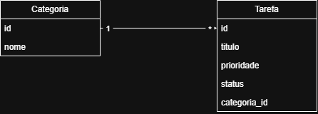
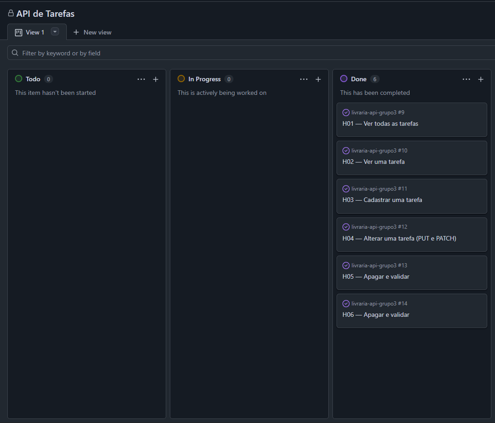

# API de Tarefas

**Aluno(a):** Luis Miguel Pereira da Silva

API de gestão de tarefas feita com Node.js, Express e MySQL, no padrão MVC.

## Como rodar

1. `npm install`
2. Copie o arquivo `.env.example` para `.env` e coloque a senha do seu MySQL.
3. No MySQL Workbench, abra e rode o arquivo `src/database/todo.sql` (raio ⚡).
4. `npm run dev` → o terminal mostra `Conectado ao MySQL!`.
5. Para conferir a API, em outro terminal: `npm run conferir`.

## Endpoints

| Método | Rota | O que faz | Status de sucesso |
|---|---|---|:---:|
| GET | `/tarefas` | Lista todas as tarefas | 200 |
| GET | `/tarefas/:id` | Busca uma tarefa pelo ID | 200 |
| POST | `/tarefas` | Cadastra uma tarefa | 201 |
| PUT | `/tarefas/:id` | Substitui os dados de uma tarefa | 200 |
| PATCH | `/tarefas/:id` | Altera somente os campos enviados | 200 |
| DELETE | `/tarefas/:id` | Apaga uma tarefa | 204 |
| GET | `/categorias` | Lista todas as categorias | 200 |
| GET | `/categorias/:id` | Busca uma categoria pelo ID | 200 |
| POST | `/categorias` | Cadastra uma categoria | 201 |
| DELETE | `/categorias/:id` | Apaga uma categoria sem tarefas vinculadas | 204 |
| PUT | `/categorias/:id` | Altera o nome da categoria (bônus B2) | 200 |
| PATCH | `/categorias/:id` | Altera o nome da categoria (bônus B2) | 200 |

### Campos da tarefa

- `id`: número gerado pelo banco.
- `titulo`: texto obrigatório.
- `prioridade`: `baixa`, `media` ou `alta`.
- `status`: `a_fazer`, `fazendo` ou `feita`.
- `categoria_id`: ID de uma categoria existente; opcional.

As respostas das tarefas incluem o campo `categoria`, com o nome da categoria relacionada. Quando a tarefa não possui categoria, o valor é `null`.

### Campos da categoria

- `id`: número gerado pelo banco.
- `nome`: texto obrigatório.

### Bônus

- **B1 — Filtros:** `GET /tarefas?status=fazendo` e `GET /tarefas?prioridade=alta`.
- **B2 — Alterar categoria:** `PUT /categorias/:id` e `PATCH /categorias/:id`.
- **B3 — JSON mal escrito:** corpos JSON inválidos respondem com status 400.

## Diagrama de classes

---

# Acompanhamento do projeto

**Quadro usado:** GitHub Projects.

## Sprint 1 — Tarefas

### Quadro no início

### Quadro no fim

### Placar do Sprint 1

- **Sprint 1 — Tarefas: 14 de 14**
- **Bônus após o Sprint 1: 2 de 5** (filtros B1).

## Sprint 2 — Categorias e relacionamento

O Sprint 2 implementa as histórias H07 a H10: cadastro e consulta de categorias, relacionamento entre tarefas e categorias por JOIN, proteção da chave estrangeira e documentação das rotas.

O quadro do início e o quadro do fim desta sprint devem ser registrados em `docs/sprint2-inicio.png` e `docs/sprint2-fim.png`.

**Placar do Sprint 2 e bônus:** atualizar depois de executar `npm run conferir` com o banco recriado pelo script atualizado.

## Reflexão final

- **O que aprendi:** Aprendi a organizar uma API no padrão MVC, separar rotas, controllers e services, trabalhar com CRUD, consultas SQL, chave estrangeira e JOIN. Também pratiquei validações e o tratamento de erros HTTP.
- **O que foi mais difícil:** A parte mais difícil foi relacionar as tarefas às categorias sem quebrar as consultas que já funcionavam no Sprint 1, principalmente usando JOIN e tratando tentativas de cadastrar ou apagar categorias inválidas.
- **O que eu faria diferente:** Eu testaria cada história assim que terminasse sua implementação, manteria o quadro atualizado e verificaria o banco depois de cada mudança no SQL.
